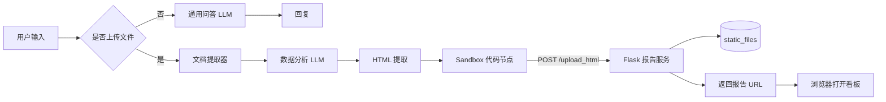

<div align="center">

# Dify Data Visualization Workflow

**从数据文件到可交互的分析报告。**

使用 Dify Chatflow 编排文件解析与模型分析，通过 Flask 保存生成的 HTML 页面，并提供独立的浏览器访问地址。

<p>
  
  
  
  
</p>

[项目概览](#overview) · [工作流程](#workflow) · [快速部署](#quick-start) · [故障排查](#troubleshooting)

</div>

---

<a id="overview"></a>

## 关于项目

日常业务分析常从一份 Excel 开始，经过数据理解、指标梳理和图表制作，最终形成可供讨论的报告。本仓库把这几步串到同一条 Dify Chatflow 中：用户上传文件，模型根据解析后的内容组织分析和图表，Flask 将生成的页面保存为 HTML，并返回访问链接。

这是一个**面向已有 Dify 环境的工作流示例与配套报告服务**，不是 Dify 的完整发行版，也不是替代数据库或 BI 系统的分析引擎。它更适合小规模数据探索、业务报表原型和内部演示。

| 场景 | 当前实现 |
| :--- | :--- |
| 数据问答 | 未上传文件时，走通用问答分支 |
| 文件分析 | 上传 Excel / CSV 后，由文档提取器向模型提供文本 |
| 可视化 | 模型生成包含 ECharts 的完整 HTML 页面 |
| 报告交付 | Flask 保存文件，返回浏览器可访问的 URL |

> **项目状态**：核心链路已在 Dify 1.15.0 的本地 Docker 环境中排查与调试；本仓库为整理后的可复用配置，尚未提供自动化端到端验收结果。模型输出的数值和图表仍需根据原始数据复核。

<a id="workflow"></a>

## 工作流程



### 设计说明

Dify 负责文件输入、条件分支、模型调用与 HTML 提取；Flask 只负责接收 HTML、落盘和文件访问。二者通过 Docker 内网通信，报告链接则面向用户浏览器。

| 用途 | 地址示例 | 谁来访问 |
| :--- | :--- | :--- |
| 上传报告 | `http://flask-app:5000/upload_html` | Dify Sandbox |
| 查看报告 | `http://YOUR_SERVER_IP:5000/download/report_xxx.html` | 用户浏览器 |
| 健康检查 | `http://flask-app:5000/health` | Docker 内部服务 |

`flask-app` 是 Docker 网络中的服务名，不能直接作为局域网浏览器的地址。

## 项目结构

```text
Dify-Data-Visualization-Workflow/
├── README.md
├── html_server.py                 # HTML 上传、保存、下载接口
├── Dockerfile.flask               # Flask 容器构建
├── docker-compose.override.yaml  # 叠加至已有 Dify Compose
├── .env.example                   # 环境变量说明
├── .gitignore
├── workflow/
│   └── Excel 数据可视化分析.yml  # Dify Chatflow DSL
└── static_files/
    └── .gitkeep                   # 本地报告目录占位
```

<a id="quick-start"></a>

## 快速部署

### 前提条件

- 已部署且运行正常的 **Dify 1.15.0**；其他版本需要自行验证兼容性。
- Docker Compose v2，能够运行 Linux 容器（Windows 用户通常使用 Docker Desktop + WSL2）。
- Dify 已配置可用的大语言模型；DSL 引用了 **OpenAI API Compatible** 插件和示例模型 `ark-code-latest`，导入后需绑定你自己的模型配置。
- 浏览器能够访问部署机器上经过授权的报告访问地址。默认示例使用 5000 端口。

**不需要迁移 Dify 的数据库或原始 `.env`。** 本项目只在已有 Dify 上增加一个 Flask 服务，再导入工作流。

### 1. 获取项目文件

```bash
git clone https://github.com/dreambet/Dify-Data-Visualization-Workflow.git
cd Dify-Data-Visualization-Workflow
```

将以下三个文件复制到**现有 Dify 安装目录中的 `docker/`**（与官方 `docker-compose.yaml`、`.env` 同级）：

```text
html_server.py
Dockerfile.flask
docker-compose.override.yaml
```

随后在该目录创建空的 `static_files/` 文件夹。已有报告无需复制；新生成的 HTML 将自动写入此目录。

### 2. 配置报告访问地址

在 **Dify 原有的 `docker/.env`** 中追加：

```dotenv
REPORT_PUBLIC_BASE_URL=http://YOUR_SERVER_IP:5000
```

将 `YOUR_SERVER_IP` 替换为客户端浏览器实际能够访问的宿主机 IP 或域名。不要用本仓库的 `.env.example` 覆盖 Dify 原有的 `.env`。

### 3. 构建并启动 Flask

进入 Dify 的 `docker/` 目录，先验证合并后的 Compose，再启动新增服务：

```powershell
docker compose -f docker-compose.yaml -f docker-compose.override.yaml config --quiet
docker compose -f docker-compose.yaml -f docker-compose.override.yaml up -d --build flask-app
docker compose -f docker-compose.yaml -f docker-compose.override.yaml ps flask-app
```

`docker-compose.override.yaml` 在原有 Compose 之上增加 `flask-app`，并将其同时连接到 `default` 和 `ssrf_proxy_network`。请保留 Dify 官方配置及其既有数据卷；**不要为此执行 `docker compose down -v`**。

### 4. 验证 Sandbox 通信

仍在 Dify `docker/` 目录执行：

```powershell
docker compose -f docker-compose.yaml -f docker-compose.override.yaml exec sandbox getent hosts flask-app
docker compose -f docker-compose.yaml -f docker-compose.override.yaml exec sandbox curl -fsS http://flask-app:5000/health
```

预期：第一条显示容器网络地址；第二条返回：

```json
{"status":"ok"}
```

这一步必须从 **sandbox** 验证。仅在 `worker` 容器里访问成功，并不能证明代码节点能够访问 Flask。

### 5. 导入 Chatflow

在 Dify 工作室中导入 [Excel 数据可视化分析.yml](workflow/Excel%20数据可视化分析.yml)，然后逐项检查：

1. 安装 DSL 所依赖的模型插件，并重新配置两个 LLM 节点。
2. 确认“解析链接”代码节点向 `http://flask-app:5000/upload_html` 发送 `html_content`。
3. 上传一份脱敏的测试 Excel / CSV，运行文件分析分支；再测试未上传文件的问答分支。
4. 检查报告文件是否出现在 `static_files/`，并使用实际浏览器打开返回的链接。

报告页面使用 ECharts CDN；浏览器无法访问该资源时，图表可能无法加载。

<a id="troubleshooting"></a>

## 故障排查

以下问题来自项目实际调试过程。

| 现象 | 原因与处理 |
| :--- | :--- |
| `Temporary failure in name resolution` | 代码节点执行于 Sandbox；确认 `flask-app` 与 Sandbox 处于相同的 `ssrf_proxy_network`。 |
| 手工连接网络后恢复，重建容器后再次失败 | `docker network connect` 只修改当前容器；使用 Compose 配置固化网络连接。 |
| 上传成功，报告链接返回 404 | 原始实现与 Flask 默认 `/static` 路由重叠。仓库代码已关闭默认静态路由，使用 `/download/<filename>`。 |
| Docker 内可访问，其他电脑打不开 | 检查 `REPORT_PUBLIC_BASE_URL`、主机端口映射、Windows 防火墙和网络访问策略。 |
| 导入 DSL 后模型节点无法运行 | DSL 不携带模型凭据；需要安装插件并重新绑定有权限调用的模型。 |
| 页面可以打开，但图表空白 | 检查 ECharts CDN 是否可达，以及模型生成的 HTML/JS 是否有效。 |

## 实现边界与安全

- **报告由模型生成，不保证所有计算与图表完全正确。** 大文件、复杂工作表以及超出模型上下文的内容，可能出现遗漏；关键业务指标应人工核对。
- `POST /upload_html` 当前没有身份认证，生成的报告也没有访问权限和自动过期机制。**请仅在可信内网试用，不要直接将 5000 端口暴露到公网。**
- HTML 可包含脚本；访问报告前应确认内容可信。生产化需要增加鉴权、HTTPS、访问控制、内容约束与定期清理。
- 是否向外部发送数据取决于你在 Dify 配置的模型服务商。使用第三方模型 API 时，表格提取内容可能传输到外部服务。
- 生成文件位于 `static_files/`，该目录中的报告文件不应提交到 GitHub。

## 许可状态

本仓库当前**尚未包含 LICENSE 文件**。如果计划开放他人修改、再分发或商用，请由仓库维护者明确选择并添加许可证；README 不预设 MIT 或其他许可。

---

<div align="center">

基于 <a href="https://github.com/langgenius/dify">Dify</a> · <a href="https://flask.palletsprojects.com/">Flask</a> · <a href="https://echarts.apache.org/">Apache ECharts</a>

</div>
